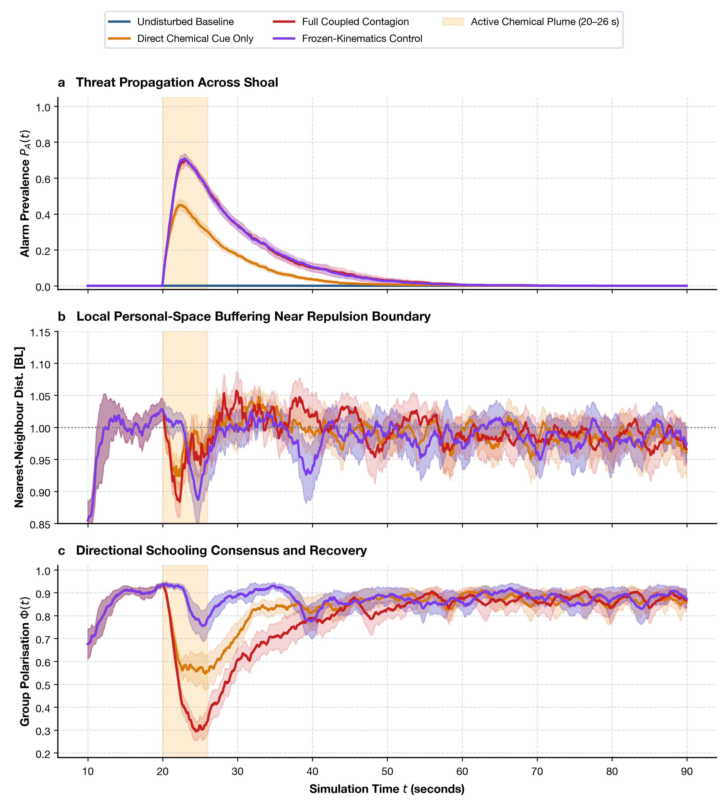
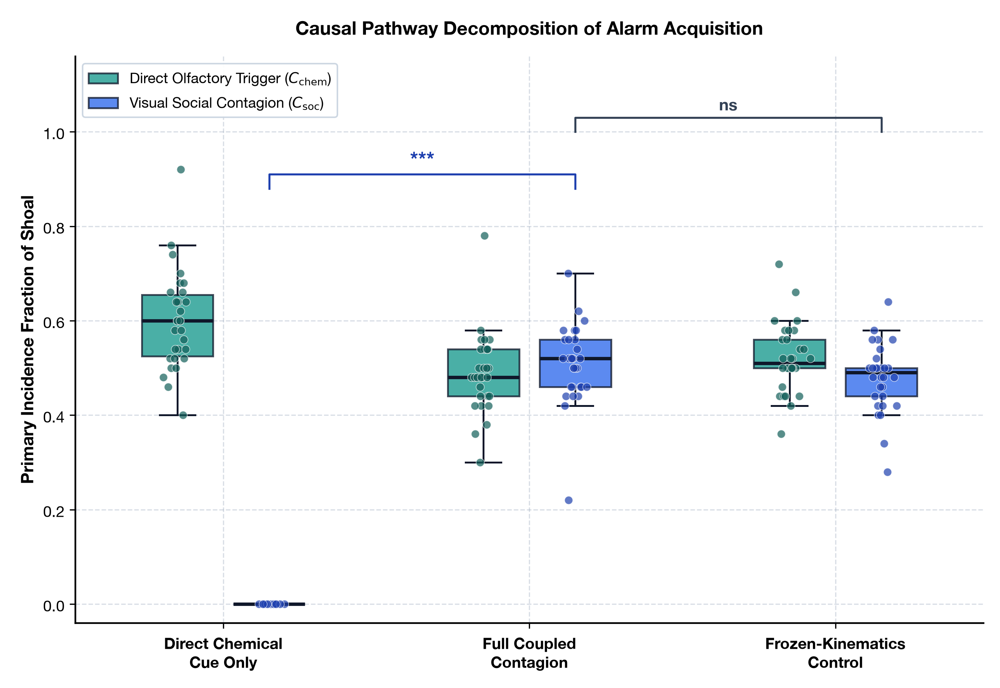
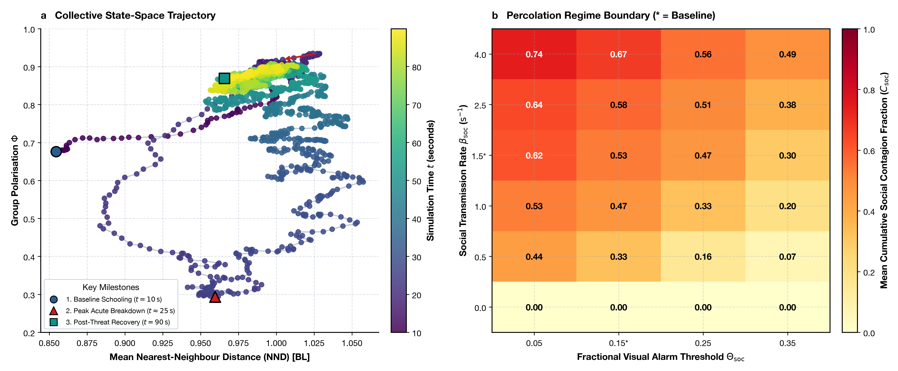

# FearFlow: Zebrafish Alarm Contagion & Collective Behaviour ABM
### *In Silico* Disambiguation of Olfactory vs. Visual Fear Propagation in Shoaling Zebrafish (*Danio rerio*)

[](https://www.python.org/downloads/)


**Framework:** 2D Continuous Agent-Based Model (Couzin Zonal Social Forces + Olfactory Plume + Visual Contact Process)

---

## 1. Overview & Biological Motivation

When shoaling zebrafish (*Danio rerio*) encounter chemical alarm substance (*Schreckstoff*) released from injured conspecific skin, they execute sudden erratic darting, speed escalation, and lose directional schooling cohesion. In real-world aquatic environments and physical laboratory tanks, two distinct sensory pathways operate simultaneously:
1. **Direct Chemosensory Olfaction:** Scent molecules diffusing through the fluid medium to stimulate olfactory crypt neurons.
2. **Visual Social Contagion:** Fish observing erratic escape darting in neighboring conspecifics and adopting the alarm state without smelling the substance.

Because fluid advection and swimming maneuvers are physically entangled, physical experiments cannot selectively disable sight or scent without disrupting hydrodynamics or schooling cohesion. **FearFlow** resolves this empirical confound *in silico* across **30 paired stochastic replicates** ($N = 50$ agents per shoal, 120 total 90-second simulations).

---

## 2. Experimental Design

The model evaluates four controlled conditions using identical paired random number seeds:

| Condition | Olfactory Cue Plume | Visual Social Contagion | Kinematic Response |
| :--- | :---: | :---: | :--- |
| **C1: Undisturbed Baseline** | Disabled | Disabled | Cruise speed ($v_0 = 3.0\text{ BL/s}$) |
| **C2: Direct Chemical Cue Only** | Active ($t \in [20, 26]\text{ s}$) | Disabled ($\beta_{\text{soc}} = 0$) | Darting ($7.5\text{ BL/s}$) for scent-detectors only |
| **C3: Full Coupled Contagion** | Active ($t \in [20, 26]\text{ s}$) | Enabled ($\beta_{\text{soc}} = 1.5\text{ s}^{-1}, \Theta_{\text{soc}} = 0.15$) | Full coupled panic darting ($7.5\text{ BL/s}$) |
| **C4: Frozen-Kinematics Control**| Active ($t \in [20, 26]\text{ s}$) | Enabled ($\beta_{\text{soc}} = 1.5\text{ s}^{-1}, \Theta_{\text{soc}} = 0.15$) | Alarm tracked, but speed held at cruise ($3.0\text{ BL/s}$) |

---

## 3. Key Findings

Across 30 paired stochastic replicates (means $\pm$ SD):

| Metric | C1 Baseline | C2 Chem Only | C3 Full Coupled | C4 Frozen Control | Statistical Contrast (C3 vs Ref) |
| :--- | :---: | :---: | :---: | :---: | :--- |
| **Peak Threat Prevalence ($P_{A,\max}$)** | $0.000$ | $0.477 \pm 0.084$ | **$0.747 \pm 0.077$** | $0.753 \pm 0.069$ | **$p = 1.71 \times 10^{-6}$** vs C2 (Cliff's $\delta = +0.96$) |
| **Acute Nearest-Neighbour Distance (BL)** | $0.987 \pm 0.020$ | $0.996 \pm 0.021$ | $0.990 \pm 0.020$ | $0.987 \pm 0.020$ | **$p = 0.655$** vs C1 (Repulsion floor bounded) |
| **Acute Group Alignment ($\Phi$)** | $0.876 \pm 0.025$ | $0.695 \pm 0.068$ | **$0.544 \pm 0.077$** | $0.876 \pm 0.025$ | **$p = 1.86 \times 10^{-9}$** vs C1 (Cliff's $\delta = -1.00$) |
| **Primary Visual Transmission ($C_{\text{soc}}$)** | $0.000$ | $0.000$ | **$0.509 \pm 0.083$** | $0.479 \pm 0.072$ | **$50.9\%$** of all primary alarm transitions |

### Core Discoveries:
1. **Visual Contagion Amplifies Panic by +57%:** Without visual transmission (C2), alarm is strictly bounded to the $47.7\%$ of fish intersecting the chemical plume. Enabling visual contagion (C3) nearly doubles peak prevalence to $74.7\%$ ($p < 10^{-6}$).
2. **Equal Causal Split in Primary Infection:** In C3, **$50.9\%$ of primary alarm transitions occur via visual social observation**, demonstrating that visual cascades rival direct olfaction.
3. **Alignment Breakdown Overrides Geometric Compression:** Rather than compressing the group, panic darting shatters directional consensus ($\Phi$ drops from $0.88$ to $0.54$, Cliff's $\delta = -1.00$), while personal-space repulsion ($r_{\text{rep}} = 1.0\text{ BL}$) strictly preserves inter-individual distance.
4. **Kinematic Feedback Modulates Propagation:** Comparing C3 against frozen-kinematics C4 confirms that speed escalation from $3.0$ to $7.5\text{ BL/s}$ dynamically reorganizes neighbor topology, significantly modulating transmission ($p = 0.015$).

---

## 4. Publication Figures

### Figure 1 | Threat Dynamics, Spatial Buffering, and Alignment Collapse

*(a) Threat prevalence $P_A(t)$ with active plume window (amber). (b) Nearest-neighbour distance buffered near $1.0\text{ BL}$. (c) Catastrophic drop and recovery of group polarisation $\Phi(t)$.*

---

### Figure 2 | Causal Pathway Decomposition of Alarm Acquisition

*Boxplots with jittered replicate points showing Direct Olfactory Trigger ($C_{\text{chem}}$, teal) vs. Visual Social Contagion ($C_{\text{soc}}$, cobalt) across C2, C3, and C4.*

---

### Figure 3 | State-Space Trajectory & 2D Percolation Regime Boundary

*(a) Clockwise hysteresis loop in collective state-space $(\text{NND}, \Phi)$ from baseline schooling (circle) through acute breakdown (triangle) to recovery (square). (b) 2D parameter regime heatmap showing critical phase boundary across social transmission rate $\beta_{\text{soc}}$ and visual threshold $\Theta_{\text{soc}}$ ($\ast = \text{calibrated baseline}$).*

---

## 5. Repository Structure

```text
FearFlow/
├── README.md                      # Project technical overview and results summary
├── requirements.txt               # Minimal Python dependencies                        
├── run.py                         # One-command simulation entrypoint
├── zebrafish_alarm_abm/           # Core simulation package
│   ├── __init__.py                # Package exports
│   ├── config.py                  # Simulation parameters & condition definitions
│   ├── kinematics.py              # Couzin social forces, geometry & steering
│   ├── simulator.py               # Replicate execution & state transition engine
│   ├── run_experiments.py         # Multi-replicate runner & figure generator
│   └── tests/                     # Deterministic verification test suite
│       └── test_abm.py            # 7 unit tests (100% passing)
├── results/                       # Empirical datasets
│   ├── core_experiments_summary.csv
│   ├── core_experiments_timeseries.csv.gz
│   ├── hypothesis_test_results.csv
│   └── sensitivity_sweep_summary.csv
└── figures/                       # Publication-grade figures (300 DPI)
    ├── fig1_timeseries_ribbons.png
    ├── fig2_causal_decomposition.png
    ├── fig3_phasespace_trajectory.png
    ├── fig3_state_and_sensitivity.png
    └── fig4_sensitivity_heatmap.png
```

---

## 6. Quickstart & Reproduction

### Installation
```bash
git clone https://github.com/tshrayansh/FearFlow.git
cd FearFlow
pip install -r requirements.txt
```

### Run Verification Tests
```bash
pytest
# Output: 7 passed in ~0.74s
```

### Run Simulation Campaign & Regenerate Figures
```bash
# Rapid figure regeneration from existing datasets:
python run.py

# Or re-run all 120 stochastic simulation replicates from scratch:
python zebrafish_alarm_abm/run_experiments.py --rerun
```

---

